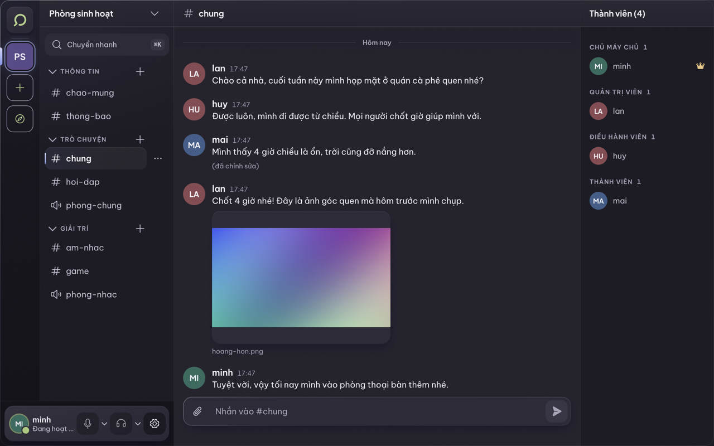
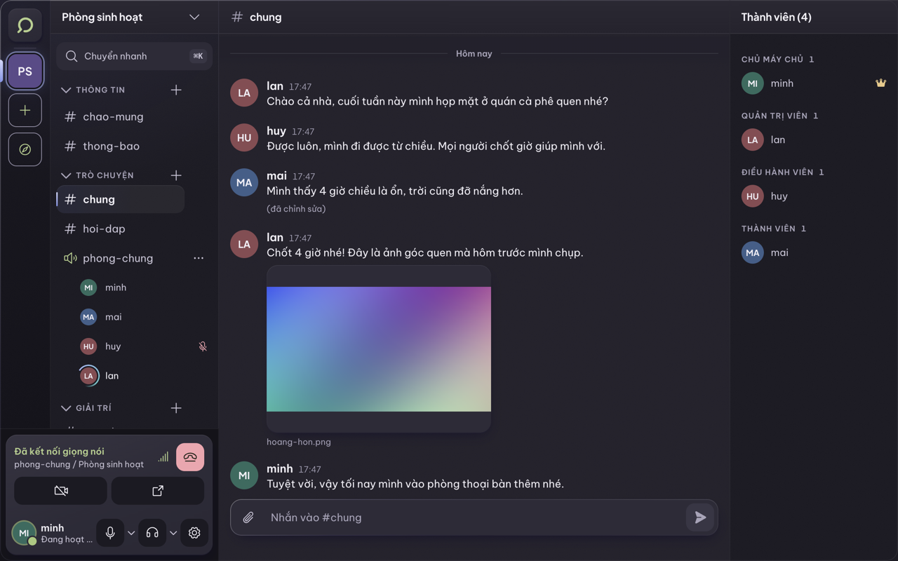
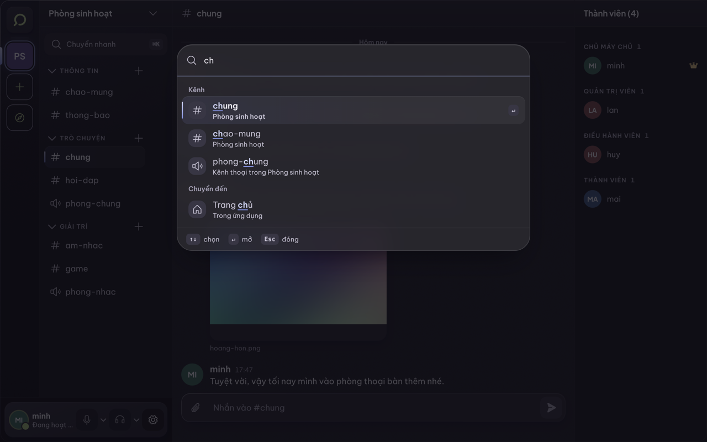
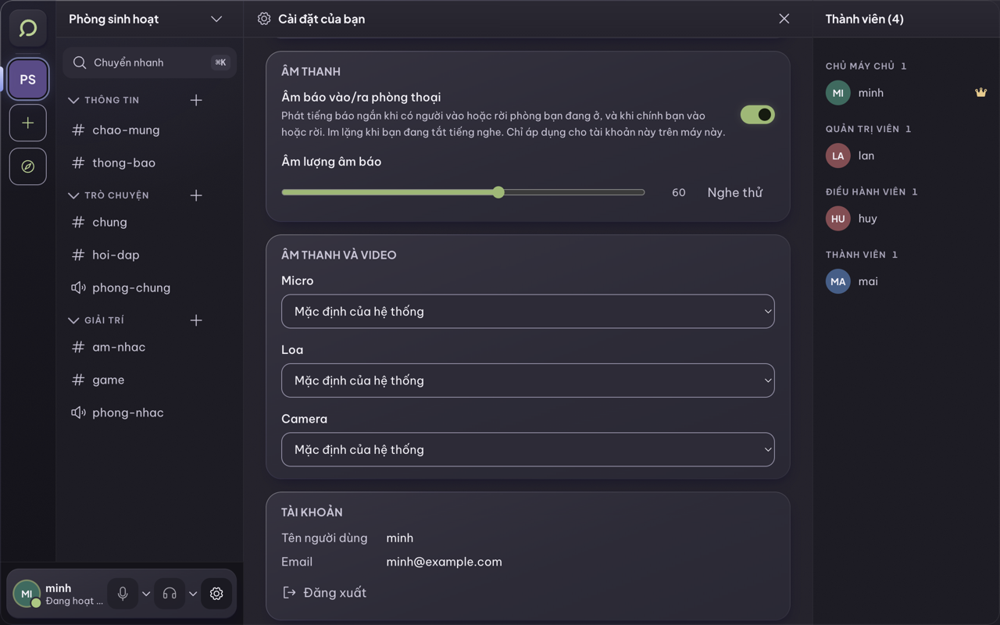
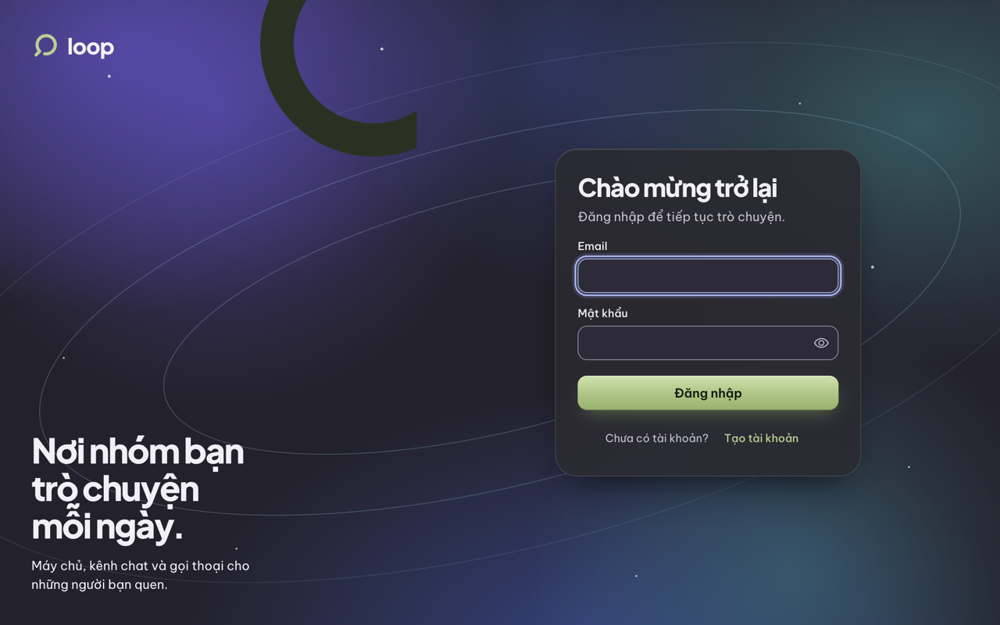

# Loop

**Ứng dụng chat cộng đồng cho Windows và macOS.** Máy chủ riêng với kênh chữ và kênh thoại được gom theo danh mục, tin nhắn riêng, bạn bè, vai trò và quyền chi tiết, tệp đính kèm, gọi thoại và video, tất cả theo thời gian thực.

[](https://github.com/fonghtdev/loop/actions/workflows/ci.yml)
[](https://github.com/fonghtdev/loop/releases/latest)


## Mục lục

- [Tải về](#tải-về)
- [Tính năng](#tính-năng)
- [Giao diện](#giao-diện)
- [Kiến trúc](#kiến-trúc)
- [Công nghệ](#công-nghệ)
- [Chạy trên máy phát triển](#chạy-trên-máy-phát-triển)
- [Kiểm thử](#kiểm-thử)
- [Cấu trúc thư mục](#cấu-trúc)
- [Cấu hình](#cấu-hình-env)
- [Triển khai và phát hành](#đóng-gói-và-phát-hành)
- [Bảo mật](#bảo-mật)
- [Trạng thái và giới hạn](#trạng-thái-và-giới-hạn)

## Tải về

Bản mới nhất ở trang **[Releases](https://github.com/fonghtdev/loop/releases/latest)**.

| Máy của bạn | Tệp |
|---|---|
| Mac chip Apple (M1, M2, M3...) | `Loop-<phiên bản>-mac-apple-silicon.dmg` |
| Mac Intel | `Loop-<phiên bản>-mac-intel.dmg` |
| Windows 64-bit | `Loop-Setup-<phiên bản>-windows-x64.exe` |

Bản cài **chưa được ký số**, nên hệ điều hành sẽ cảnh báo lần đầu mở:

- **macOS:** kéo Loop vào Applications, **chuột phải vào Loop, chọn Open, rồi Open**. Nếu vẫn báo không mở được: `xattr -cr /Applications/Loop.app`.
- **Windows:** khi hiện "Windows protected your PC", bấm **More info**, rồi **Run anyway**.

Gỡ cài đặt ngay trong app: Cài đặt, cuối trang, **Gỡ cài đặt Loop**. Việc này xóa app và dữ liệu của nó trên máy; tài khoản và dữ liệu trên máy chủ được giữ nguyên.

## Tính năng

**Cộng đồng**
- Máy chủ với **danh mục** và kênh chữ/kênh thoại: tạo, đổi tên, xóa, thu gọn theo từng tài khoản, **kéo thả** để sắp xếp (hoặc dùng menu bằng bàn phím).
- Lời mời bằng mã, rời, đuổi thành viên, chuyển quyền chủ, xóa máy chủ.
- **Vai trò và quyền** theo bitmask, ghi đè quyền theo từng kênh, luật phân cấp chống leo thang quyền.

**Trò chuyện**
- Tin nhắn thời gian thực, lịch sử có phân trang, sửa và xóa tin, đồng bộ lại khi mất kết nối.
- **Tệp và ảnh đính kèm** (tối đa 25 MB mỗi tệp, 10 tệp mỗi tin; ảnh, PDF, văn bản, ZIP, MP4, MP3) với xem ảnh phóng to.
- Tin nhắn riêng (DM), bạn bè, chặn người dùng, chấm trạng thái trực tuyến.
- Đếm tin chưa đọc, thông báo của hệ điều hành, biểu tượng khay hệ thống.

**Thoại và video**
- Vào kênh thoại bằng một cú nhấp; micro, tai nghe, camera, chọn thiết bị vào/ra.
- Gọi 1-1 thoại hoặc video trong tin nhắn riêng.
- Âm báo khi có người vào/ra phòng (tắt/bật và chỉnh âm lượng trong Cài đặt).
- Truyền qua [LiveKit](https://livekit.io), thu hồi quyền ngay khi bị đổi vai trò hoặc bị đuổi.

**Trải nghiệm**
- **Chuyển nhanh** bằng Ctrl+K (macOS: Cmd+K): tìm máy chủ, kênh, tin nhắn riêng, bạn bè mà không cần gõ dấu.
- Giao diện tiếng Việt, tối ưu cho bàn phím, tôn trọng chế độ giảm chuyển động của hệ điều hành.
- Thu vào khay, mở cùng máy, chỉ một cửa sổ chạy một lúc.

## Giao diện



*Máy chủ với danh mục, kênh chữ và kênh thoại, tin nhắn có ảnh, vai trò thành viên ở cột phải.*

| | |
|---|---|
|  |  |
| *Phòng thoại: ai đang nói, ai tắt micro, thanh điều khiển cuộc gọi ở góc dưới trái.* | *Chuyển nhanh (Ctrl+K / Cmd+K): tìm kênh, máy chủ, bạn bè mà không cần gõ dấu.* |
|  |  |
| *Cài đặt: âm báo vào/ra phòng thoại, âm lượng, chọn micro, loa và camera.* | *Màn hình đăng nhập.* |

## Kiến trúc

```
        Ứng dụng desktop (Electron + React)
                 |  HTTPS / WSS (REST + Socket.IO)            |  WSS (thoại, video)
                 v                                            v
        +---------------------+                      +----------------+
        |  Máy chủ Loop       |  token, webhook      |    LiveKit     |
        |  Fastify + Socket.IO| <------------------> |  (Cloud/Docker)|
        +----------+----------+                      +----------------+
          |        |        |
          v        v        v
     PostgreSQL   Redis   S3 / Cloudflare R2
     (dữ liệu)  (realtime, (tệp đính kèm,
                 giới hạn)  URL ký sẵn)
```

- **REST là nguồn sự thật**, Socket.IO chỉ đẩy sự kiện; mọi kiểm tra quyền đi qua một lớp duy nhất dùng chung giữa server và app (`packages/shared`).
- Tệp được tải thẳng lên kho S3 bằng URL ký sẵn rồi server **xác minh nội dung** (kích thước, loại tệp qua chữ ký đầu tệp) trước khi cho đính vào tin nhắn.
- Redis nối nhiều instance server (Socket.IO adapter, nên trạng thái trực tuyến tính đúng xuyên instance) và giữ bộ đếm giới hạn tần suất.

## Công nghệ

| Lớp | Công nghệ |
|---|---|
| Desktop | Electron, React, Vite, Tailwind CSS, TanStack Query, Zustand, `livekit-client` |
| Server | Node.js 22, Fastify, Socket.IO, Prisma, PostgreSQL, Redis, LiveKit Server SDK |
| Lưu trữ | S3 tương thích (MinIO khi phát triển, Cloudflare R2 khi chạy thật) |
| Dùng chung | TypeScript, zod |
| Công cụ | pnpm workspace, Vitest, Playwright (Electron), GitHub Actions, electron-builder |

## Chạy trên máy phát triển

**Cần có:**

| Công cụ | Ghi chú |
|---|---|
| Node.js 22 trở lên | đã chạy thử trên Node 26 |
| pnpm 12 | cài bằng `npm i -g pnpm` (Node 26 không còn kèm corepack) |
| Docker Desktop | chạy Postgres, Redis, MinIO và LiveKit. **Phải bật trước khi bắt đầu** |

**Chạy lần đầu:**

```bash
# 1. Cài thư viện
pnpm install

# 2. Tạo file cấu hình, rồi đổi JWT_SECRET (ít nhất 32 ký tự)
cp .env.example .env
openssl rand -base64 48        # dán kết quả vào JWT_SECRET trong .env

# 3. Bật Postgres, Redis, MinIO, LiveKit (chờ tới khi healthy)
docker compose up -d --wait

# 4. Build một lần (dựng @loop/shared và sinh Prisma client)
pnpm build

# 5. Tạo bảng trong database
pnpm --filter @loop/server db:deploy
```

**Chạy hằng ngày** (hai cửa sổ terminal, ở thư mục gốc):

```bash
pnpm --filter @loop/server dev      # terminal 1: server, cổng 3000
pnpm --filter @loop/desktop dev     # terminal 2: app desktop (cửa sổ Electron)
```

Lần đầu chạy app desktop, Electron tải bộ chạy của nó (vài chục MB) nên hơi lâu. Trong app, bấm **Tạo tài khoản** (tên người dùng gồm chữ thường không dấu, số, `_`, `.`; mật khẩu từ 8 ký tự), rồi bấm **+** ở cột trái để tạo máy chủ.

**Tắt mọi thứ:** `Ctrl+C` ở mỗi terminal; `docker compose stop` tắt dịch vụ nền nhưng giữ dữ liệu (bật lại bằng `docker compose up -d --wait`).

## Kiểm thử

```bash
pnpm lint      # kiểm tra kiểu TypeScript cho shared, server, desktop
pnpm build
pnpm test      # test shared, desktop và server (cần Docker đang chạy)
```

Test server dùng database `loop_test`, Redis index 1 và bucket `loop-test`, nên không đụng dữ liệu dev.

Test end-to-end của app (mở cửa sổ Electron thật, cần server dev đang chạy và Docker bật):

```bash
pnpm --filter @loop/desktop e2e
```

## Cấu trúc

```
apps/server      Fastify + Prisma + Socket.IO (REST, realtime, LiveKit, S3)
apps/desktop     Electron + React + Tailwind (main, preload, renderer)
packages/shared  schema zod, quyền (computePermissions) dùng chung server và app
deploy/          cấu hình triển khai: Docker Compose + Caddy, Render, sao lưu
docker/          cấu hình LiveKit và khởi tạo database cho môi trường phát triển
docs/            hướng dẫn triển khai (DEPLOY.md)
```

## Cấu hình (`.env`)

| Biến | Ý nghĩa |
|---|---|
| `DATABASE_URL` | Postgres |
| `JWT_SECRET` | khóa ký token, ít nhất 32 ký tự, **đừng dùng giá trị mẫu khi chạy thật** |
| `REDIS_URL` | Redis (nối nhiều instance server và trạng thái online) |
| `S3_*` | kho tệp (MinIO khi dev, Cloudflare R2 khi chạy thật) |
| `LIVEKIT_*` | máy chủ voice/video (Docker khi dev, LiveKit Cloud khi chạy thật) |
| `CORS_ORIGINS` | nguồn được gọi API. Dev dùng `http://localhost:5173`, bản đóng gói dùng `app://loop`. Để trống là không cho nguồn nào |

Địa chỉ server mà app desktop gọi mặc định là `http://localhost:3000`. Đổi bằng biến `VITE_API_URL` lúc chạy hoặc build app. Tệp đính kèm nằm ở kho S3 (MinIO, mặc định `http://localhost:9000`); đổi origin của nó cho app bằng `VITE_STORAGE_ORIGIN`.

## Gặp lỗi?

| Triệu chứng | Cách xử lý |
|---|---|
| `Cannot connect to the Docker daemon` | bật Docker Desktop rồi chạy lại `docker compose up -d --wait` |
| `Environment variable not found: DATABASE_URL` | chưa có file `.env` ở thư mục gốc (`cp .env.example .env`) |
| Server báo thiếu biến môi trường lúc khởi động | so lại `.env` với `.env.example`, thiếu biến nào server báo biến đó |
| `Bind for 0.0.0.0:5432 failed` (hoặc 6379, 9000, 7880...) | cổng đang bị chương trình khác giữ (ví dụ Postgres cài bằng Homebrew); tắt nó hoặc đổi cổng trong `docker-compose.yml` |
| `ERR_PNPM_IGNORED_BUILDS` khi cài | thêm gói được báo vào `allowBuilds` trong `pnpm-workspace.yaml` |
| Cổng 3000 báo đang bận | còn một server dev cũ chạy nền: `lsof -nP -iTCP:3000 -sTCP:LISTEN`, rồi tắt tiến trình `tsx watch` (cả tiến trình cha) |
| App desktop báo không kết nối được server | server ở terminal 1 chưa chạy, hoặc `CORS_ORIGINS` thiếu `http://localhost:5173` |
| Voice không hiện người tham gia | LiveKit gửi webhook về `http://host.docker.internal:3000`, cần server chạy ở cổng 3000 |

## Xóa sạch dữ liệu dev

```bash
docker compose down -v     # XÓA toàn bộ dữ liệu Postgres, Redis, MinIO, LiveKit của dự án
```

Lệnh này không hoàn tác được. Sau đó chạy lại từ bước 3 ở phần "Chạy lần đầu".

## Đóng gói và phát hành

Bản đóng gói **chưa ký** (chưa có chữ ký số, chưa notarize): chạy được để thử, nhưng chưa nên phát cho người dùng thật.

```bash
# Cần: địa chỉ server thật, được "đóng cứng" vào app lúc build (xem bảng dưới)
export VITE_API_URL=https://api.example.com VITE_STORAGE_ORIGIN=https://files.example.com VITE_LIVEKIT_ORIGIN=wss://xxx.livekit.cloud
pnpm --filter @loop/desktop dist        # máy đang dùng: macOS -> .dmg + .zip, Windows -> installer
pnpm --filter @loop/desktop dist:dir    # chỉ thư mục chạy được (nhanh nhất), để thử
pnpm --filter @loop/desktop dist:mac    # dmg + zip (kiến trúc của máy build)
pnpm --filter @loop/desktop dist:win    # NSIS x64 (build được từ macOS, chưa chạy thử trên Windows)
```

Kết quả nằm ở `apps/desktop/release/` (đã git-ignore). Build thử trên máy với server cục bộ: thêm `LOOP_ALLOW_LOCAL=1`.

| Biến (lúc build) | Ý nghĩa |
| --- | --- |
| `VITE_API_URL` | địa chỉ server (`https://`) |
| `VITE_STORAGE_ORIGIN` | địa chỉ S3/R2 chứa tệp đính kèm (`https://`) |
| `VITE_LIVEKIT_ORIGIN` | LiveKit (`wss://`) |
| `VITE_UPDATE_URL` | (tuỳ chọn) thư mục `https://` chứa bản cập nhật; không đặt = app KHÔNG tự cập nhật và không gọi mạng để kiểm tra |

`apps/desktop/scripts/check-release-env.mjs` chạy trước mỗi `dist*`: thiếu biến, dùng `http://`/`ws://` hoặc trỏ về localhost thì dừng build với thông báo rõ. `LOOP_ALLOW_LOCAL=1` bỏ qua. `appId` (`app.loop.desktop`) là giá trị tạm; đổi cùng lúc ở `apps/desktop/electron-builder.yml` và `apps/desktop/src/shared/app-id.ts` (có test giữ hai nơi bằng nhau).

Nếu `dist` báo `spawn ENOEXEC` khi "searching for node modules": file `pnpm` trên máy bạn là script không có dòng `#!`; chạy lại với một wrapper `#!/bin/sh` + `exec pnpm "$@"` đứng đầu `PATH`.

### Ký và notarize (bạn cần tự làm; chưa bước nào được chạy)

- **macOS**: cần tài khoản Apple Developer (Developer ID Application certificate). Bỏ dòng `identity: null` trong `electron-builder.yml`, đặt `CSC_LINK` (đường dẫn/base64 file .p12) + `CSC_KEY_PASSWORD`; notarize thêm `mac.notarize: true` và `APPLE_ID`, `APPLE_APP_SPECIFIC_PASSWORD`, `APPLE_TEAM_ID`. File `apps/desktop/build/entitlements.mac.plist` (JIT, micro, camera) chỉ có tác dụng khi app được ký. Chưa ký thì Gatekeeper chặn lần mở đầu (chuột phải > Open).
- **Windows**: chứng chỉ ký code (`CSC_LINK`, `CSC_KEY_PASSWORD`). Chưa ký thì SmartScreen cảnh báo, nhưng cập nhật tự động vẫn chạy.

### Cập nhật tự động

Windows dùng `electron-updater` (provider `generic`); macOS dùng `src/main/mac-updater.ts` (xem dưới). Chỉ bật khi app đã cài (`app.isPackaged`) VÀ lúc build có `VITE_UPDATE_URL` (https). Kiểm tra sau khi mở 30 giây rồi mỗi 6 giờ, tải nền, tự cài khi thoát app, không bao giờ ép khởi động lại (nút "Khởi động lại để cập nhật" ở Cài đặt > Cập nhật).

Phát hành bản mới: tăng `version` trong `apps/desktop/package.json`, build với cùng các biến `VITE_*`, rồi tải lên `VITE_UPDATE_URL` (S3/R2 công khai, GitHub Pages hay web tĩnh bất kỳ) các file trong `release/`: `latest.yml`, `latest-mac.yml`, `.exe`, `.zip`, `.dmg` và các `.blockmap`. macOS chưa ký nên không dùng Squirrel.Mac: app đọc `latest-mac.yml` (Intel: `latest-mac-x64.yml`), báo "Có bản X", và CHỈ khi người dùng bấm "Cập nhật ngay" rồi xác nhận mới tải zip, kiểm SHA-512, thay `Loop.app` và mở lại (chi tiết: `apps/desktop/src/main/CLAUDE.md`); Windows NSIS cập nhật được cả khi chưa ký. Luồng cập nhật thật chưa được thử vì chưa có feed.

### Danh sách kiểm tra khi đưa server lên production

Hướng dẫn từng bước (Docker Compose + Caddy, R2, LiveKit Cloud, bản cài không ký, sao lưu): [docs/DEPLOY.md](docs/DEPLOY.md); file cấu hình nằm ở `deploy/`.

- `JWT_SECRET` dài, ngẫu nhiên (>= 32 ký tự), khác dev.
- `CORS_ORIGINS` phải có `app://loop` (origin của app đóng gói).
- Bucket S3/R2: bật CORS cho `PUT` và `GET` từ `app://loop`, nếu không upload/hiện ảnh trong app sẽ lỗi.
- LiveKit Cloud: đặt `LIVEKIT_URL`, `LIVEKIT_API_URL`, `LIVEKIT_API_KEY`, `LIVEKIT_API_SECRET`; client `livekit-client` đang ghim **2.9.9** cho server LiveKit **1.9.0**, nâng một bên thì kiểm tra lại cặp phiên bản.
- Mọi thứ qua HTTPS/WSS (API, storage, LiveKit, feed cập nhật).
- Rate limit (cần Redis, cùng `REDIS_URL`; đếm chung giữa các instance): **bật mặc định**, chỉ `RATE_LIMIT=off` mới tắt (chỉ dev/e2e/test, KHÔNG đặt trên production). Mặc định: toàn cục 300 yêu cầu/phút/người dùng (IP nếu chưa đăng nhập); đăng nhập 10/phút/IP và 5 lần/5 phút cho mỗi cặp (IP, email); đăng ký 5/giờ/IP; refresh 30/phút/IP; gửi tin 60/phút (và 10 trong 5 giây)/người dùng; kết bạn 20/giờ; vào invite 20/giờ; tạo guild 10/giờ; tạo upload 60/10 phút; token voice 30/phút; kết nối socket 60/phút/IP. Vượt thì 429 kèm `Retry-After`. Webhook LiveKit không bị giới hạn. Nếu Redis chết, giới hạn tạm tắt (server vẫn chạy, có log lỗi).
- **`TRUST_PROXY`**: sau reverse proxy/CDN BẮT BUỘC đặt đúng, nếu không mọi người dùng chưa đăng nhập chung một IP của proxy (bị giới hạn chung) hoặc client giả được `X-Forwarded-For` để né giới hạn. Dùng số proxy tin cậy (`TRUST_PROXY=1`) khi biết chính xác số lớp proxy; `true` chỉ đúng khi proxy ghi đè header. Không đặt khi server nhận kết nối trực tiếp.
- Sao lưu Postgres (và Redis nếu cần) định kỳ; thử khôi phục ít nhất một lần.

## Bảo mật

- Mật khẩu băm bằng **argon2**; đăng nhập bằng JWT ngắn hạn (15 phút) kèm **refresh token xoay vòng có phát hiện dùng lại** (dùng lại token cũ sẽ thu hồi toàn bộ phiên).
- Trên desktop, access token chỉ nằm trong bộ nhớ; refresh token được mã hóa bằng kho khóa của hệ điều hành (`safeStorage`) và giữ ở tiến trình chính.
- Electron cứng hóa: `contextIsolation`, `sandbox`, không `nodeIntegration`, CSP chặt, kiểm tra người gửi của mọi lệnh IPC, chặn điều hướng và cửa sổ lạ.
- Quyền kiểm tra tập trung ở server (client chỉ dùng để ẩn giao diện); quyền thoại/video bị thu hồi ngay khi vai trò thay đổi.
- Giới hạn tần suất bằng Redis cho mọi route; tệp tải lên qua URL ký sẵn và được xác minh nội dung phía server.

## Trạng thái và giới hạn

Loop đang ở giai đoạn **thử nghiệm** (beta):

- Bản cài chưa ký số và chưa notarize; chưa có tự cập nhật mặc định.
- Đã kiểm thử kỹ trên macOS; Windows có bản cài nhưng chưa được kiểm tra đầy đủ.
- Giao diện chỉ có tiếng Việt.
- Chưa có chia sẻ màn hình.
- Máy chủ thử nghiệm chạy trên gói miễn phí và tự ngủ khi vắng người dùng (lần kết nối đầu có thể chờ khoảng một phút).

## Giấy phép

Chưa công bố giấy phép: mặc định mọi quyền được bảo lưu.
